# DMOS 1.1 "Maré"

Distribuição Linux baseada no Debian 13 (trixie), com KDE Plasma 6 e uma identidade visual
própria, gerada a partir do código deste repositório.

*In English: see [About DMOS](#about-dmos-english).*

[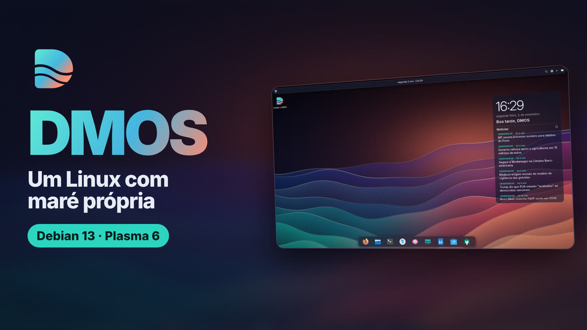](https://youtu.be/6xOphpjiomE)

**[▶ Vídeo de apresentação](https://youtu.be/6xOphpjiomE)** · **[▶ Tutorial: experimentar e instalar](https://youtu.be/glLq_Hi9V1A)** · **[▶ Instalar no VMware](https://youtu.be/j-9vXxhwyh4)** · **[▶ Instalar no Hyper-V](https://youtu.be/NariiOTl-0o)** · **[▶ 7 dicas para o dia a dia](https://youtu.be/r8VG6ZlcGRY)** · **[▶ Programas essenciais](https://youtu.be/mBz9nvQ8iWE)** · **[▶ Personalizar o DMOS](https://youtu.be/X7Uiz9RR-KA)** · [Site do DMOS](https://dmos.cc/)

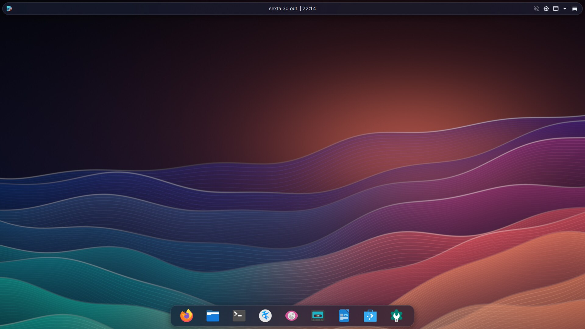

| | |
|---|---|
| 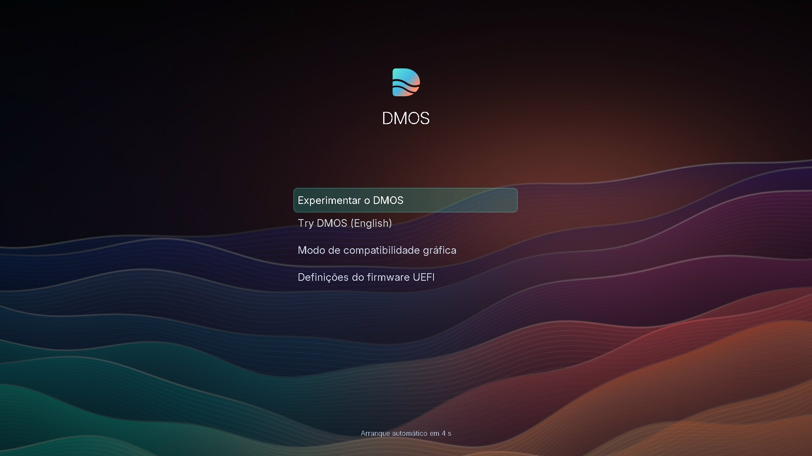 | 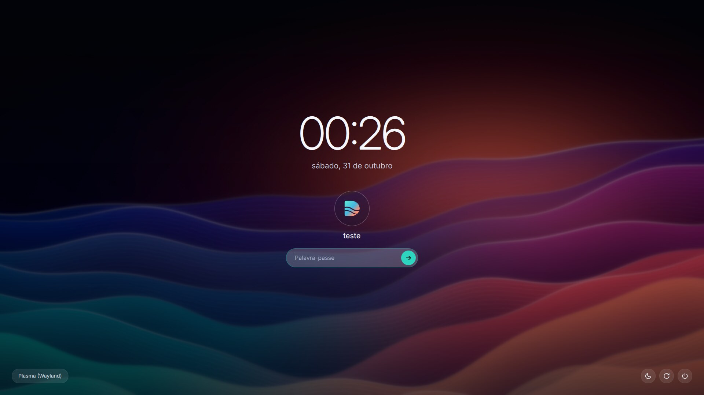 |
| 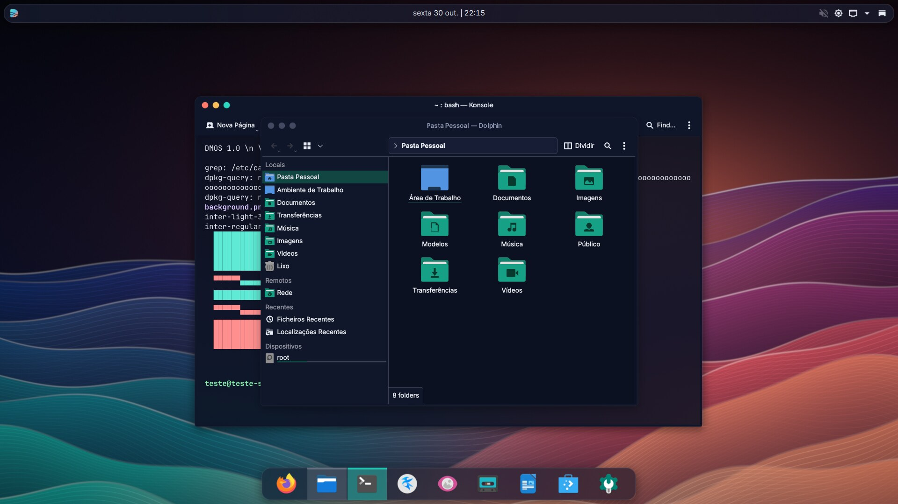 | 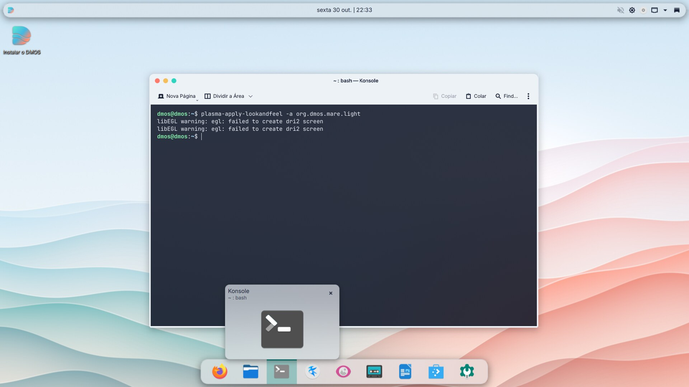 |
| 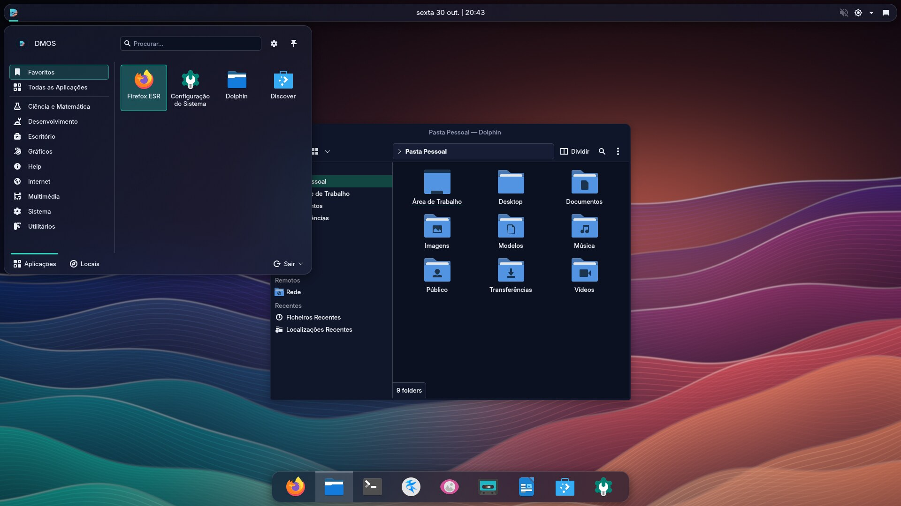 | 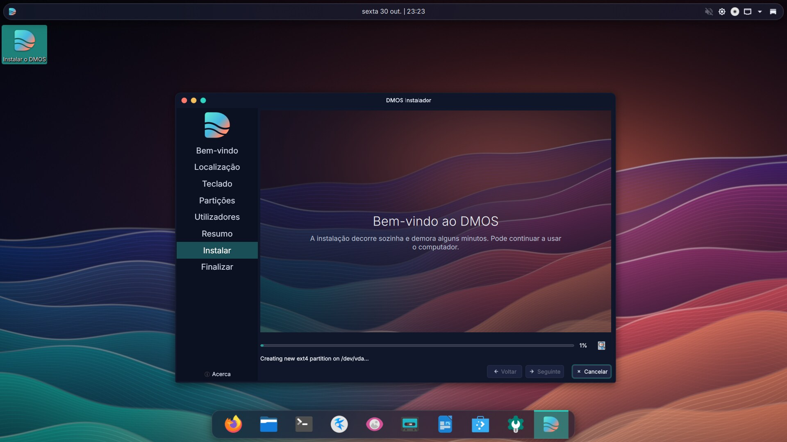 |

## Experimentar

O [tutorial em vídeo](https://youtu.be/glLq_Hi9V1A) mostra todos os passos, do download ao primeiro dia. Para o correr dentro do Windows,
veja o [tutorial do VMware Workstation](https://youtu.be/j-9vXxhwyh4) ou, no Windows Pro e Education, o
[tutorial do Hyper-V](https://youtu.be/NariiOTl-0o).

**[Descarregar a ISO do DMOS 1.1](https://sourceforge.net/projects/dmos/files/latest/download)** (2,8 GB, na SourceForge). Para confirmar que a ISO
chegou inteira, compare-a com o [`SHA256SUMS`](https://sourceforge.net/projects/dmos/files/1.1/SHA256SUMS/download):

```bash
sha256sum -c SHA256SUMS --ignore-missing
```

No Windows, use `Get-FileHash dmos-1.1-mare-amd64.hybrid.iso` no PowerShell e compare com a linha da ISO.
O código-fonte de todos os pacotes da ISO está na [mesma pasta da SourceForge](https://sourceforge.net/projects/dmos/files/1.1/).
A versão 1.0 continua [disponível na SourceForge](https://sourceforge.net/projects/dmos/files/1.0/). O que mudou está nas
[notas de versão](CHANGELOG.md).

A ISO não faz parte do repositório, por ser demasiado grande para o GitHub. Depois de a
[compilar](#compilar-a-iso), fica em `dist/dmos-1.1-mare-amd64.hybrid.iso`, com o checksum em
`dist/SHA256SUMS`. Na mesma pasta fica o arquivo com o código-fonte de todos os pacotes da ISO
(`dmos-1.1-mare-source.*`). Quem publicar a ISO deve publicar também este arquivo, porque a GPL pede que
o código-fonte acompanhe os binários.

- **Numa máquina virtual**: tipo Linux/Debian 64 bits, pelo menos 4 GB de RAM e 2 CPUs.
  Recomendados o **VMware Workstation** (grátis para uso pessoal, com aceleração 3D) e o
  **Hyper-V** (já vem no Windows Pro e Education; máquina de geração 2 com o Arranque Seguro
  desligado e memória dinâmica desligada). **VirtualBox: não recomendado**, porque o DMOS fica
  muito lento com as definições de origem; se só tiver o VirtualBox, use VMSVGA com aceleração 3D
  e 128 MB de vídeo e escolha a sessão Plasma (X11) no ecrã de entrada.
- **Numa pen USB**: grave a ISO com o [Rufus](https://rufus.ie) em modo DD, ou com o
  [balenaEtcher](https://etcher.balena.io). A gravação apaga o conteúdo da pen.

O sistema arranca sem instalar nada e entra sozinho com o utilizador `dmos`. Para o instalar, use
o ícone **Instalar o DMOS** no ambiente de trabalho. A instalação ocupa cerca de 7 GB e pede um
disco com pelo menos 15 GB.

Para mudar entre claro e escuro: **Definições do Sistema > Tema Global**, ou pelo assistente
**Bem-vindo ao DMOS**, no menu de aplicações.

## Novidades da 1.1

O Flathub vem ativado de origem, e o assistente ganhou uma página com aplicações populares a um
clique. No instalador, a legenda das partições passou a ler-se. Os pormenores estão nas
[notas de versão](CHANGELOG.md).

| | |
|---|---|
| 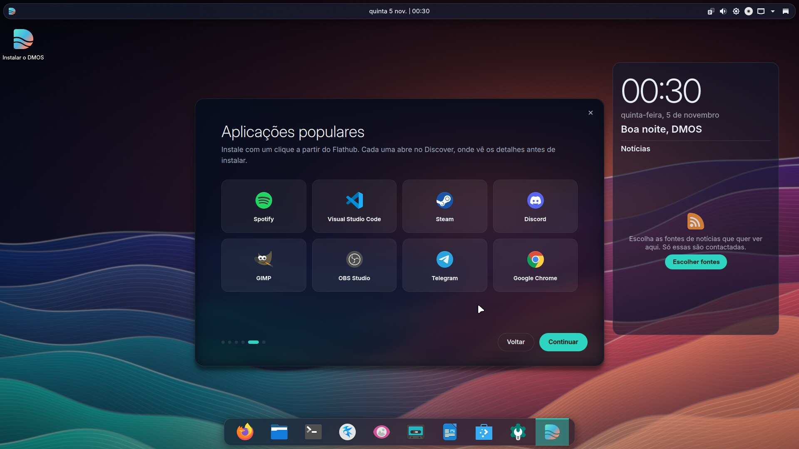 | 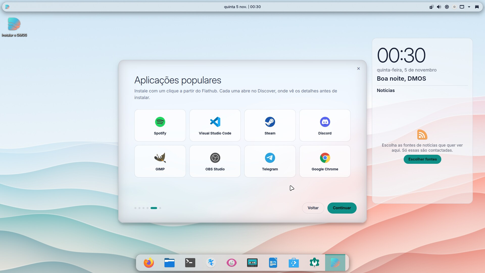 |
| 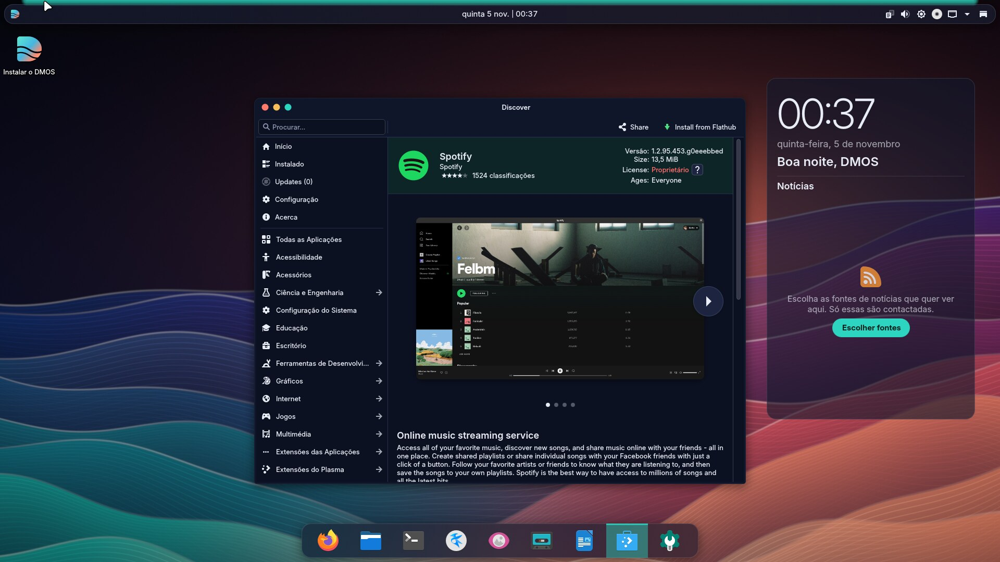 | 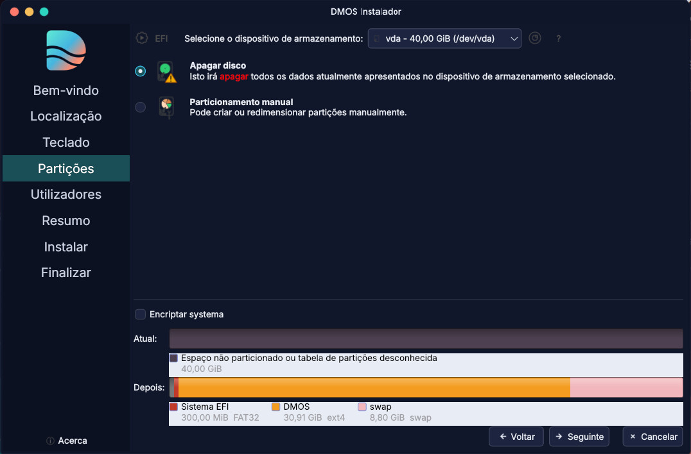 |

## Experiência DMOS

- **Bem-vindo ao DMOS**: na primeira sessão, um assistente em vidro guia por cinco passos. São
  eles: escolher o visual claro ou escuro, ver a ligação à internet, escolher as fontes de notícias,
  instalar aplicações populares e conhecer três atalhos. No modo de demonstração, oferece também
  a instalação.
- **Flathub ativado de origem**: o Discover mostra as aplicações do Flathub logo no primeiro
  arranque.
- **DMOS Hub**: painel no ambiente de trabalho com a hora, a data, uma saudação e as últimas
  notícias, intercaladas entre as fontes escolhidas. Há dez fontes, portuguesas e internacionais.
  Só as que o utilizador liga são contactadas, e por omissão nenhuma está ligada.
| | |
|---|---|
| 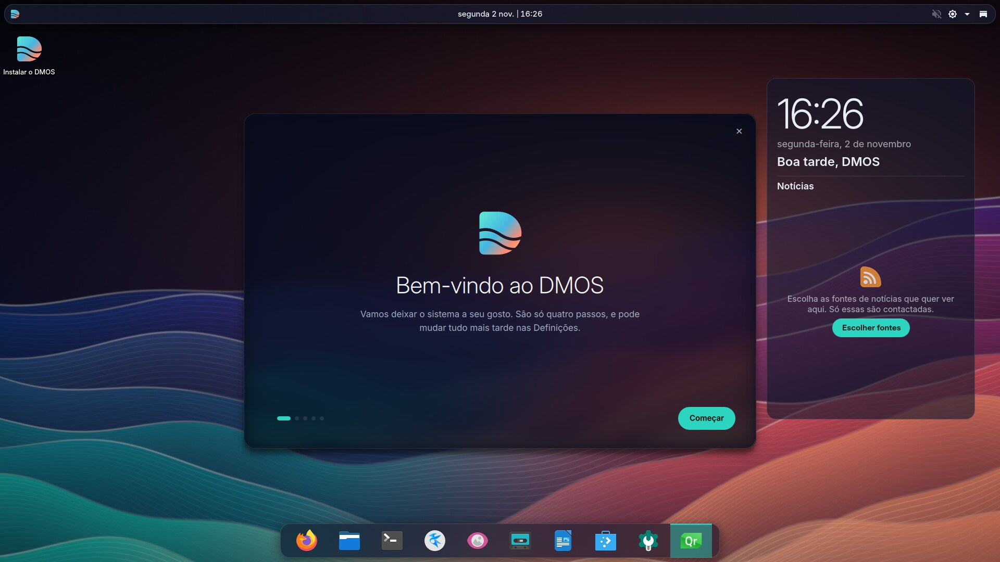 | 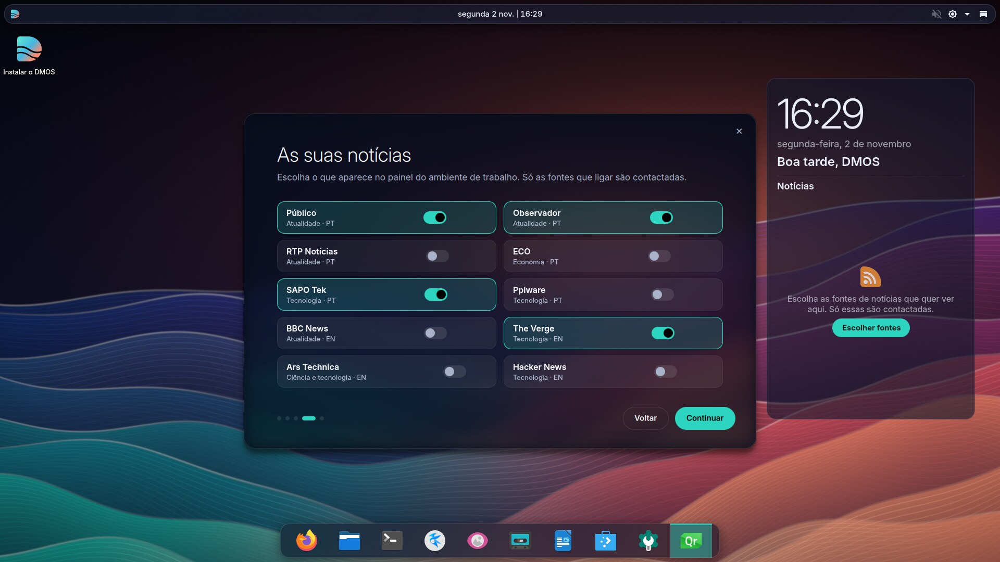 |

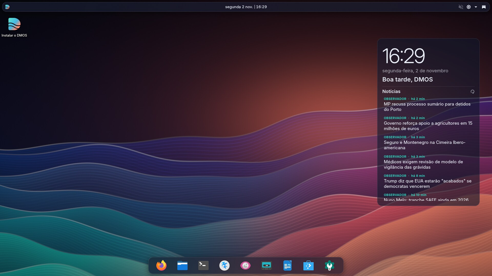

- **Português de Portugal completo** nos ecrãs de bloqueio e de "Sair", que no Debian ficavam em
  inglês. As traduções em falta ficam em `/usr/local/share/locale` e não substituem os ficheiros
  dos pacotes.

## O que foi testado

A partir da 1.1, os testes são feitos no **VMware Workstation**, com aceleração por hardware e 3D,
numa máquina virtual UEFI com 4 GB de RAM e 4 processadores.

| Teste da 1.1 | VMware |
|---|---|
| ISO até ao ambiente de trabalho (Wayland), em menos de um minuto | Sim |
| Ferramentas do VMware: resolução ajustada à janela e som | Sim |
| Assistente, com a página "Aplicações populares", nos temas escuro e claro | Sim |
| Aplicação do Flathub aberta no Discover a partir do assistente | Sim |
| Instalação completa e arranque do sistema instalado | Sim |

A instalação foi feita com a primeira compilação da 1.1. A compilação publicada só acrescenta o
catálogo do Flathub, testado na sessão de demonstração. A instalação também foi repetida no QEMU,
até ao fim, com a legenda das partições legível.

A compilação publicada da 1.1 foi ainda instalada no **Hyper-V** (Windows, máquina de geração 2 com
o Arranque Seguro desligado), do arranque da ISO ao sistema instalado, e corre bem. No
**VirtualBox** arranca, mas a sessão fica demasiado lenta com as definições de origem, por isso
não é recomendado (veja [Experimentar](#experimentar)).

Na 1.0, o menu de arranque, a sessão de demonstração e a instalação completa foram testados em BIOS
e em UEFI, no QEMU. Na 1.1 só se testou UEFI.

Em **hardware real**, a 1.1 arrancou da pen e correu num **HP Omen de 2017**. Num **Toshiba Tecra
R840 de 2011** só não arrancou enquanto a pen estava gravada com a opção «Large FAT32» do Rufus, que
as BIOS antigas não leem: a causa foi o formato da pen, não o DMOS. Grave sempre em modo DD. Se experimentar noutro
computador, conte-nos o modelo e o que funcionou.

Ainda por testar:

- **Hardware real** em mais máquinas, incluindo placas gráficas NVIDIA, AMD e Intel e Wi-Fi em
  computadores diferentes.
- **Secure Boot**: a ISO inclui os componentes assinados, mas o arranque com ele ativo não foi
  experimentado. As fontes do menu não carregam nesse modo, por isso o menu usa a fonte de base.
- Modo de compatibilidade gráfica, disco encriptado, instalação ao lado de outro sistema e
  atualização do sistema com `apt`.

## O que foi desenhado

| Peça | Onde |
|---|---|
| Wallpaper "Maré" (claro e escuro, 4K, procedural) | `art/gen_wallpaper.py` |
| Logótipo | `art/logo.svg` |
| Esquemas de cores, estilo Plasma (vidro), decoração de janelas, Konsole | `art/gen_theme.py` |
| Disposição: barra superior e dock flutuantes, ecrã de carregamento | `live/config/includes.chroot_after_packages/usr/share/plasma/look-and-feel/` |
| Ecrã de início de sessão (SDDM) | `live/config/includes.chroot_after_packages/usr/share/sddm/themes/dmos/` |
| Animação de arranque (Plymouth) | `live/config/includes.chroot_after_packages/usr/share/plymouth/themes/dmos/` |
| Menu de arranque (GRUB) | `live/config/bootloaders/grub-pc/`, `art/grub-theme.txt` |
| Instalador (Calamares) | `live/config/includes.chroot_after_packages/etc/calamares/` |
| Assistente "Bem-vindo ao DMOS" | `live/config/includes.chroot_after_packages/usr/share/dmos/welcome/` |
| Painel DMOS Hub e lista de fontes de notícias | `live/config/includes.chroot_after_packages/usr/share/plasma/plasmoids/org.dmos.hub/` |
| Traduções em falta (pt) | `live/config/hooks/live/0530-dmos-pt-translations.hook.chroot` |

Fontes: Inter e JetBrains Mono. Ícones: Papirus. Cursor: Bibata.

## Compilar a ISO

Em Windows, com o WSL 2 disponível:

```powershell
.\build.ps1
```

Na primeira vez, o script cria uma instância WSL própria, `dmos-builder`, e não toca nas outras.
A compilação precisa de cerca de 20 GB livres e demora perto de 20 minutos, mais o tempo de
descarregar os pacotes na primeira vez.

Para repetir a compilação a partir do zero, mantendo os pacotes já descarregados:

```powershell
.\build.ps1 clean
```

```powershell
.\build.ps1
```

Para apagar tudo o que a compilação criou no WSL:

```bash
wsl --unregister dmos-builder
```

## Desenvolver o tema

Dentro de `dmos-builder`, como root, `scripts/dev_preview.sh` corre o ambiente real a partir de uma
cópia do sistema e tira uma captura de ecrã, sem compilar a ISO:

```bash
bash scripts/dev_preview.sh desktop
```

Os modos são `desktop`, `sddm` e `splash`, e as capturas ficam em `art/preview/`.
`scripts/test_vmware.ps1` controla, a partir do Windows, uma sessão de demonstração no VMware
Workstation: tira capturas e abre programas dentro da sessão. `scripts/test_vm.sh` faz o mesmo em
QEMU, dentro do `dmos-builder`, mas muito mais devagar, porque o WSL não tem aceleração por hardware.

## Site

O site do projeto está em `docs/` (`index.html`, `style.css`, `main.js`) e usa as capturas de
`docs/screenshots/`. Não precisa de compilação: abra `docs/index.html` no browser. Para o publicar
no GitHub Pages, em **Settings > Pages** escolha **Deploy from a branch**, o ramo `main` e a pasta
`/docs`.

## About DMOS (English)

DMOS is a Portuguese Linux distribution based on Debian 13 "trixie", featuring KDE Plasma 6 on
Wayland and a complete visual identity of its own: boot menu (GRUB), splash screen (Plymouth),
login screen (SDDM), a glass-style Plasma theme with light and dark variants, the procedural "Maré"
wallpaper and a branded Calamares installer. All artwork and configuration are generated from the
source code in this repository.

Version 1.1 "Maré" also adds:

- **Welcome to DMOS**: a first-run assistant (light or dark look, network, news sources, popular
  apps, shortcuts).
- **Flathub enabled out of the box**: Discover lists Flathub apps from the first boot.
- **DMOS Hub**: a desktop widget with the time, a greeting and news from the sources you choose.
  No source is enabled by default, so nothing is contacted until you opt in.
- **Complete European Portuguese** translations, including the lock and logout screens.

| | |
|---|---|
| Based on | Debian 13 "trixie" (stable) |
| Desktop | KDE Plasma 6, Wayland by default |
| Architecture | x86_64 (amd64) |
| Boot | Hybrid ISO, BIOS and UEFI, live session |
| Installer | Calamares |
| Packages | APT (DEB), Flatpak |
| Default language | European Portuguese (an English live session is in the boot menu) |
| License | GPL-3.0-or-later; "Maré" wallpaper under CC BY-SA 4.0 |

**Download:** [DMOS 1.1 ISO](https://sourceforge.net/projects/dmos/files/latest/download) (2.8 GB, on SourceForge), with `SHA256SUMS` and the source code of
every package in the ISO in the [same folder](https://sourceforge.net/projects/dmos/files/1.1/).
What changed: [release notes](CHANGELOG.md) (in Portuguese).
Requirements: 64-bit PC, 4 GB of RAM, 2 CPU cores, 15 GB of disk to install.

**Testing status:** booting the ISO, the live desktop and a full install were tested on QEMU, in
both BIOS and UEFI modes. Version 1.1 was also installed on VMware Workstation and on Hyper-V
(generation 2, Secure Boot off), where it runs well. VirtualBox is not recommended: the desktop is
very slow with its default settings (use VMSVGA with 3D acceleration and the Plasma X11 session if
you must). On real hardware, 1.1 boots and runs from a USB stick on an HP Omen (2017); a Toshiba Tecra
R840 (2011) only failed while the USB stick was written with Rufus's "Large FAT32" option, which old
BIOSes cannot read: write the stick in DD mode. Secure Boot has not been tested yet.

**Building:** on Windows with WSL 2, run `.\build.ps1` (see [Compilar a ISO](#compilar-a-iso)). It
uses live-build inside a dedicated `dmos-builder` WSL instance.

Website: <https://dmos.cc/> · Videos (Portuguese):
<https://www.youtube.com/playlist?list=PLbQLRzz4S7rQ>

DMOS is an independent project and is not affiliated with Debian or KDE.

## Licença

O código e os temas deste repositório estão sob a [GPL-3.0-or-later](LICENSE). Exceção: o wallpaper
"Maré" que `art/gen_wallpaper.py` gera está sob a CC BY-SA 4.0.

O Debian, o KDE Plasma, as fontes, os ícones e as outras aplicações incluídas na ISO mantêm as
licenças próprias.
