# DMOS 1.2 "Maré"

Distribuição Linux baseada no Debian 13 (trixie), com KDE Plasma 6 e uma identidade visual
própria, gerada a partir do código deste repositório.

*In English: see [About DMOS](#about-dmos-english).*

[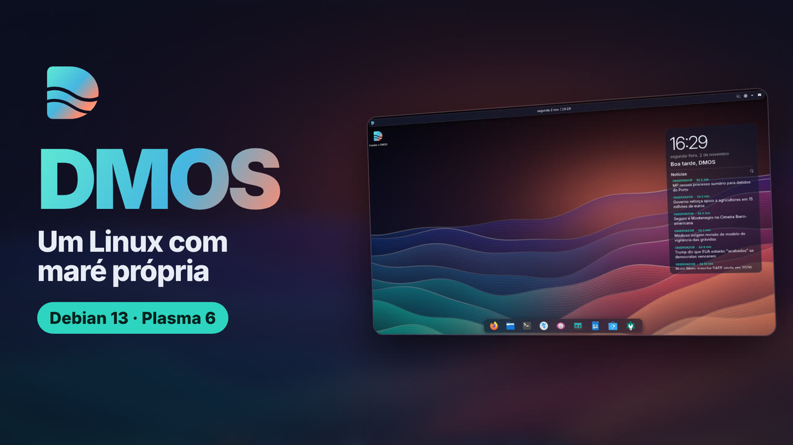](https://youtu.be/6xOphpjiomE)

**[▶ Vídeo de apresentação](https://youtu.be/6xOphpjiomE)** · **[▶ Novidades da 1.2](https://youtu.be/C-d2rYN2Q1I)** · **[▶ Tour da 1.1](https://youtu.be/v97XyyNyhDE)** · **[▶ Tutorial: experimentar e instalar](https://youtu.be/glLq_Hi9V1A)** · **[▶ Instalar no VMware](https://youtu.be/j-9vXxhwyh4)** · **[▶ Instalar no Hyper-V](https://youtu.be/NariiOTl-0o)** · **[▶ 7 dicas para o dia a dia](https://youtu.be/r8VG6ZlcGRY)** · **[▶ Programas essenciais](https://youtu.be/mBz9nvQ8iWE)** · **[▶ Personalizar o DMOS](https://youtu.be/X7Uiz9RR-KA)** · [TikTok](https://www.tiktok.com/@dmos.linux) · [Site do DMOS](https://dmos.cc/)

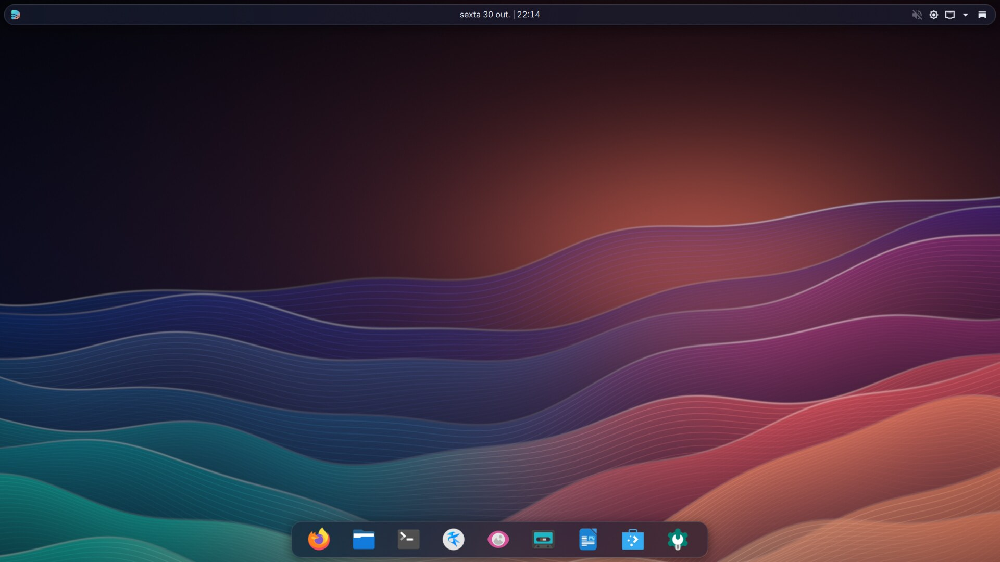

| | |
|---|---|
| 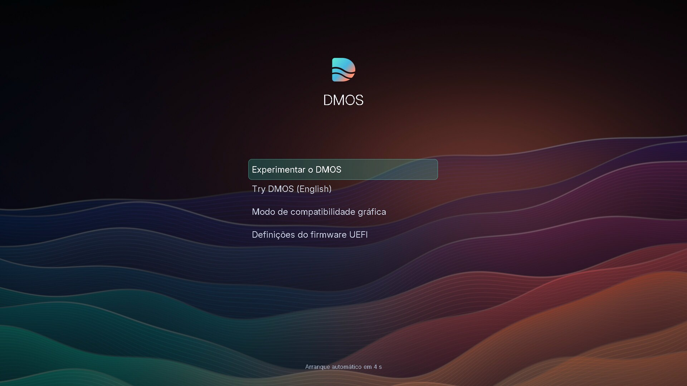 | 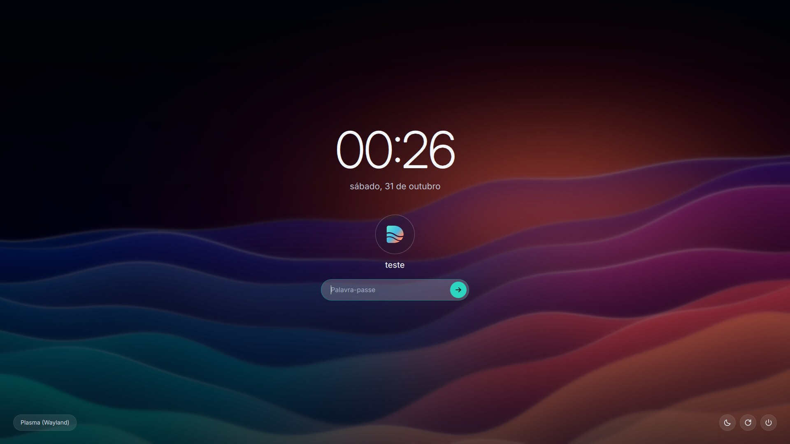 |
| 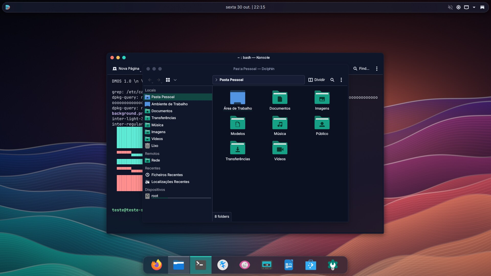 | 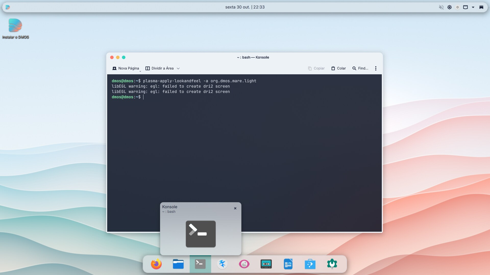 |
| 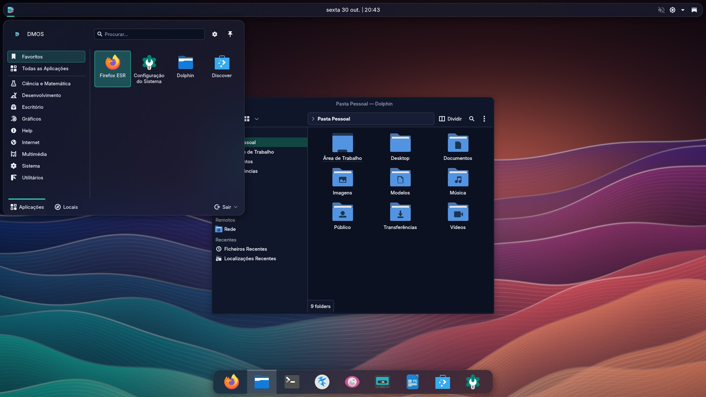 | 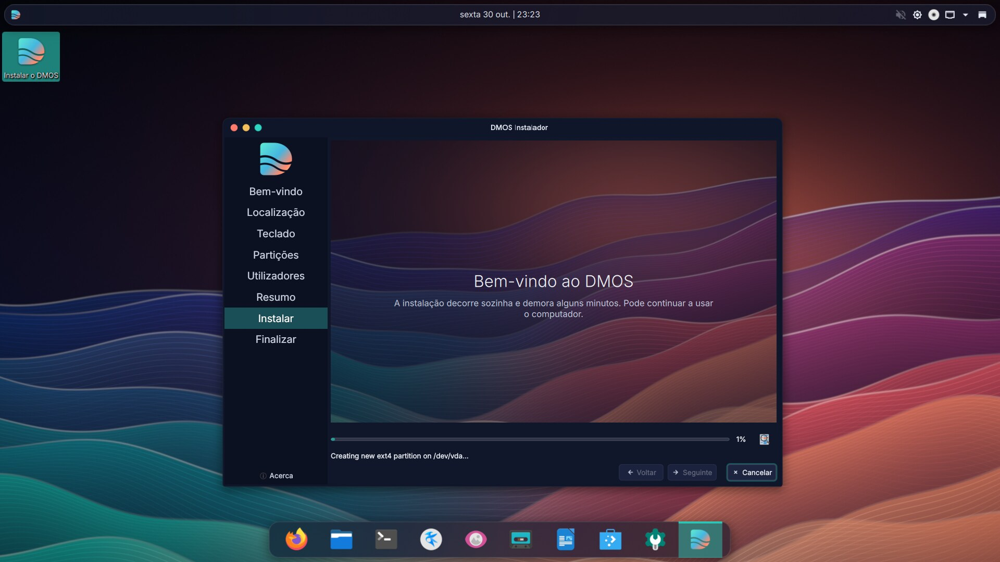 |

## Experimentar

O [tutorial em vídeo](https://youtu.be/glLq_Hi9V1A) mostra todos os passos, do download ao primeiro dia. Para o correr dentro do Windows,
veja o [tutorial do VMware Workstation](https://youtu.be/j-9vXxhwyh4) ou, no Windows Pro e Education, o
[tutorial do Hyper-V](https://youtu.be/NariiOTl-0o).

**[Descarregar a ISO do DMOS 1.2](https://sourceforge.net/projects/dmos/files/latest/download)** (2,9 GB, na SourceForge). Para confirmar que a ISO
chegou inteira, compare-a com o [`SHA256SUMS`](https://sourceforge.net/projects/dmos/files/1.2/SHA256SUMS/download):

```bash
sha256sum -c SHA256SUMS --ignore-missing
```

No Windows, use `Get-FileHash dmos-1.2-mare-amd64.hybrid.iso` no PowerShell e compare com a linha da ISO.
O código-fonte de todos os pacotes da ISO está na [mesma pasta da SourceForge](https://sourceforge.net/projects/dmos/files/1.2/).
As versões [1.1](https://sourceforge.net/projects/dmos/files/1.1/) e [1.0](https://sourceforge.net/projects/dmos/files/1.0/)
continuam disponíveis na SourceForge. O que mudou está nas [notas de versão](CHANGELOG.md).

A ISO não faz parte do repositório, por ser demasiado grande para o GitHub. Depois de a
[compilar](#compilar-a-iso), fica em `dist/dmos-1.2-mare-amd64.hybrid.iso`, com o checksum em
`dist/SHA256SUMS`. Na mesma pasta fica o arquivo com o código-fonte de todos os pacotes da ISO
(`dmos-1.2-mare-source.*`). Quem publicar a ISO deve publicar também este arquivo, porque a GPL pede que
o código-fonte acompanhe os binários.

- **Numa máquina virtual**: tipo Linux/Debian 64 bits, pelo menos 4 GB de RAM e 2 CPUs.
  Recomendados o **VMware Workstation** (grátis para uso pessoal, com aceleração 3D) e o
  **Hyper-V** (já vem no Windows Pro e Education; máquina de geração 2 com o Arranque Seguro
  desligado e memória dinâmica desligada). **VirtualBox: não recomendado**, porque o DMOS fica
  muito lento com as definições de origem; se só tiver o VirtualBox, use VMSVGA com aceleração 3D
  e 128 MB de vídeo e escolha a sessão Plasma (X11) no ecrã de entrada.
- **Numa pen USB**: grave a ISO com o [Rufus](https://rufus.ie) em modo DD, ou com o
  [balenaEtcher](https://etcher.balena.io). A gravação apaga o conteúdo da pen.

O sistema arranca sem instalar nada e entra sozinho com o utilizador `dmos`. Para o instalar, use
o ícone **Instalar o DMOS** no ambiente de trabalho. A instalação ocupa cerca de 7 GB e pede um
disco com pelo menos 15 GB.

Para mudar entre claro e escuro: **Definições do Sistema > Tema Global**, ou pelo assistente
**Bem-vindo ao DMOS**, no menu de aplicações. O assistente também muda o fundo e a cor de destaque.

## Novidades da 1.2

A 1.2 traz a **DMOS IA**, um assistente de pesquisa que responde com as fontes; uma página **Cor e
fundo** no assistente, com dois fundos novos e seis cores de destaque; e um **painel de aplicações**
em ecrã inteiro, na dock e em **Super + A**. O assistente, o DMOS Hub e a DMOS IA passam a aparecer
em inglês na sessão em inglês. Os pormenores estão nas [notas de versão](CHANGELOG.md).

| | |
|---|---|
| 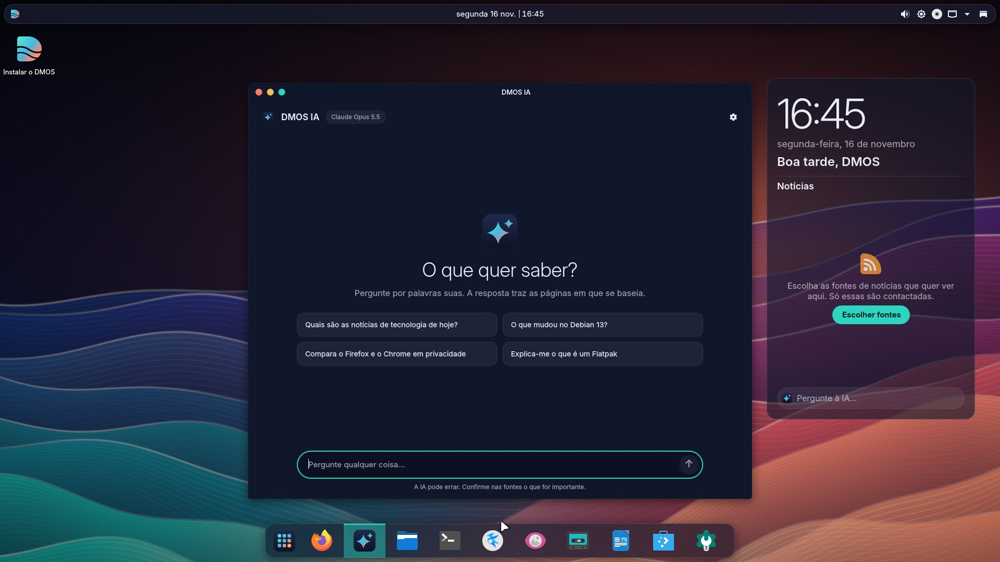 | 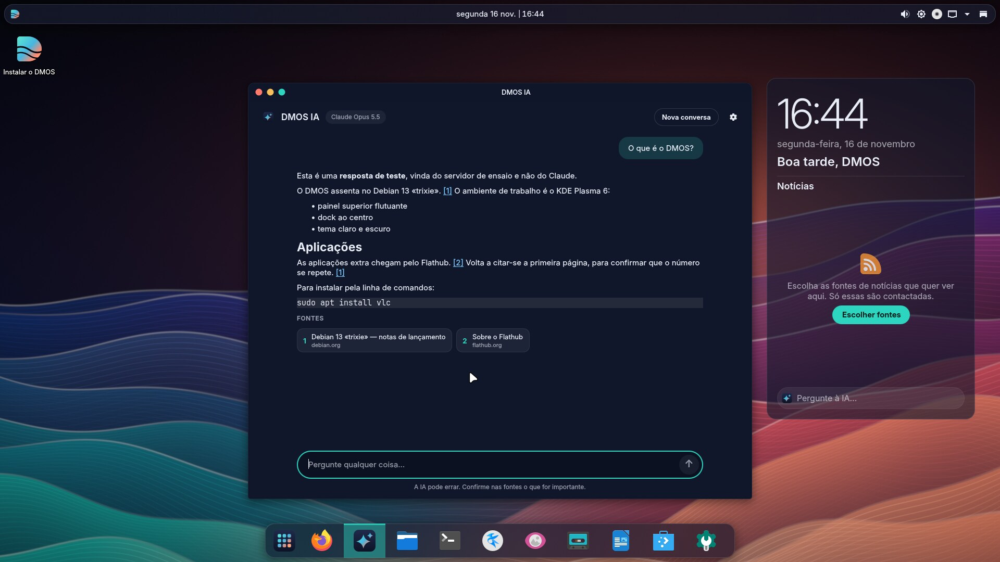 |
| 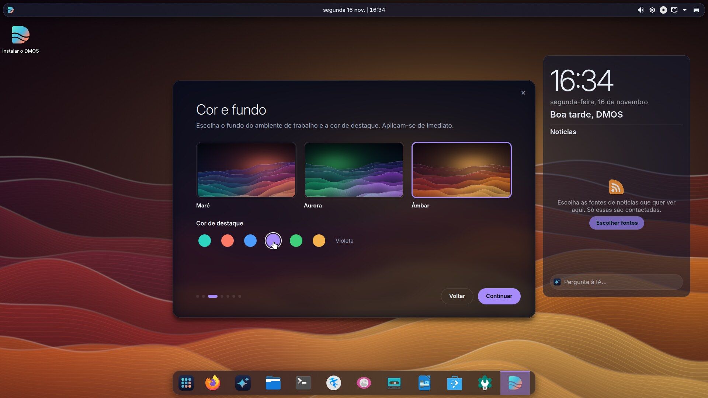 | 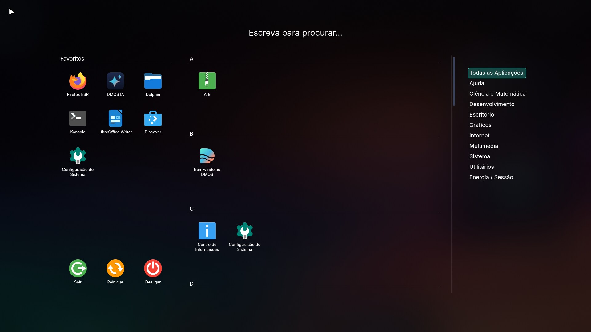 |

A resposta da segunda captura vem do servidor de ensaio do projeto (`scripts/fake_claude.py`), e
não do Claude: as capturas foram tiradas sem chave nenhuma.

### DMOS IA: como funciona e o que envia

- Quem responde é o **Claude**, da Anthropic, através da API. Quando a pergunta depende de factos
  atuais, o Claude pesquisa na web e cita as páginas que usou; a aplicação mostra-as numeradas por
  baixo da resposta.
- **A chave é sua.** Na primeira vez, a aplicação pede uma chave da API da Anthropic, que se cria em
  [platform.claude.com](https://platform.claude.com/settings/keys). O uso é pago à Anthropic, à
  medida do que se usa. A ISO não traz chave nenhuma.
- **O que sai do computador:** as perguntas e a conversa em curso, enviadas à Anthropic para serem
  respondidas, e a chave, enviada só à Anthropic. Sem chave, a aplicação não contacta ninguém. A
  chave fica em `~/.config/dmos/ia.key`, legível apenas pelo utilizador, e apaga-se nas definições
  da aplicação. As conversas não são guardadas em disco.
- **Modelo:** por omissão o Claude Opus 5.5; nas definições pode escolher-se o Sonnet 5.5 ou o
  Haiku 5.5, mais rápidos e mais baratos. Se o modelo recusar um pedido, a Anthropic pode entregar
  a resposta de outro modelo seu, e a aplicação diz qual foi.
- A IA pode errar. Confirme nas fontes o que for importante.

## Novidades da 1.1

O Flathub vem ativado de origem, e o assistente ganhou uma página com aplicações populares a um
clique. No instalador, a legenda das partições passou a ler-se. Os pormenores estão nas
[notas de versão](CHANGELOG.md).

| | |
|---|---|
| 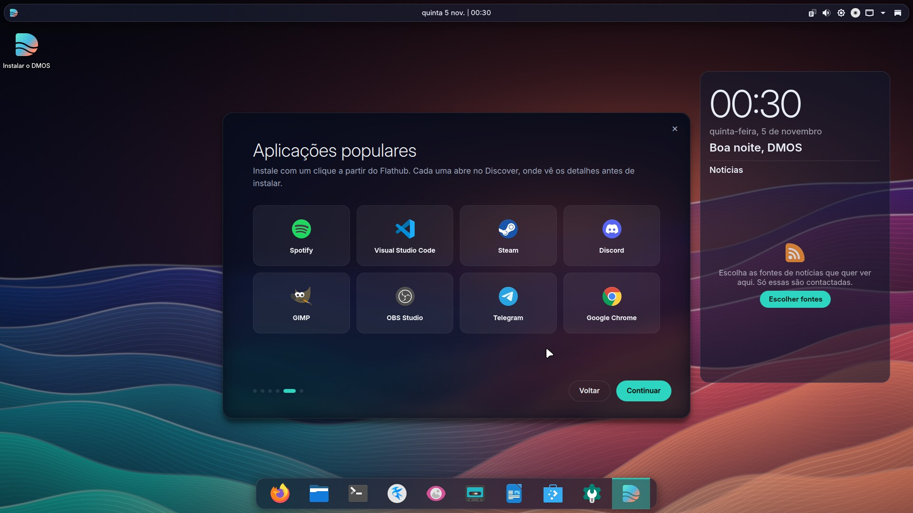 | 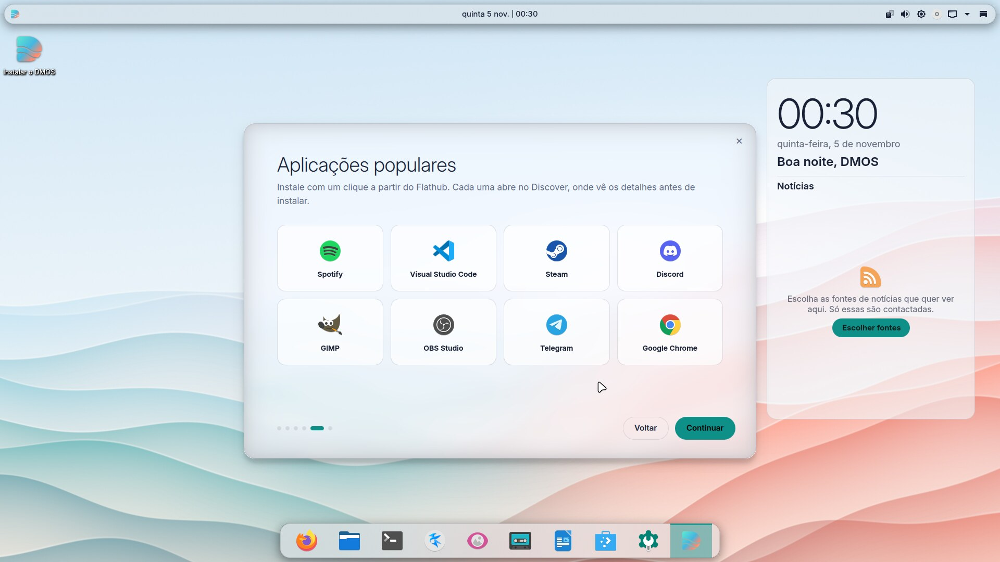 |
| 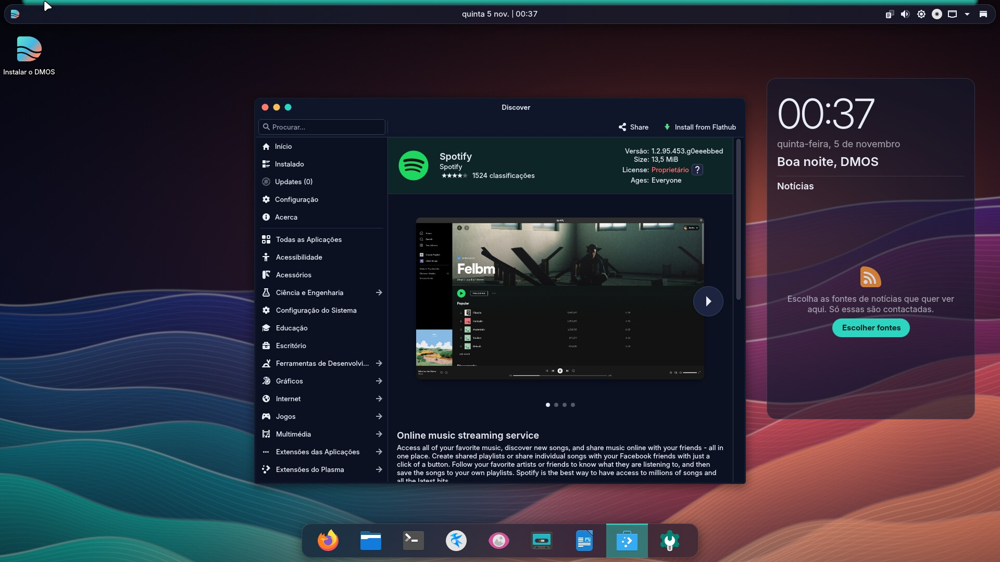 | 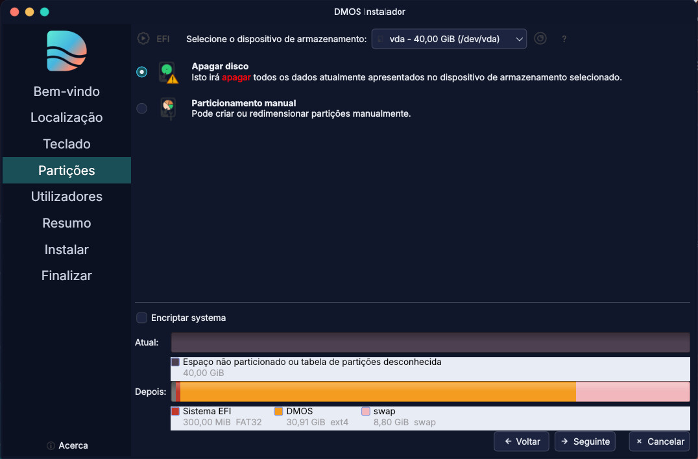 |

## Experiência DMOS

- **Bem-vindo ao DMOS**: na primeira sessão, um assistente em vidro guia por seis passos. São
  eles: escolher o visual claro ou escuro, escolher o fundo e a cor de destaque, ver a ligação à
  internet, escolher as fontes de notícias, instalar aplicações populares e conhecer quatro
  atalhos. No modo de demonstração, oferece também a instalação.
- **DMOS IA**: assistente de pesquisa com o Claude, que responde com as fontes. Usa a chave da API
  de cada pessoa ([como funciona](#dmos-ia-como-funciona-e-o-que-envia)).
- **Painel de aplicações**: todas as aplicações em ecrã inteiro, no primeiro botão da dock ou com
  **Super + A**.
- **Flathub ativado de origem**: o Discover mostra as aplicações do Flathub logo no primeiro
  arranque.
- **DMOS Hub**: painel no ambiente de trabalho com a hora, a data, uma saudação e as últimas
  notícias, intercaladas entre as fontes escolhidas. Há dez fontes, portuguesas e internacionais.
  Só as que o utilizador liga são contactadas, e por omissão nenhuma está ligada. Em baixo, o
  campo «Pergunte à IA…» abre a DMOS IA já com a pergunta feita.
| | |
|---|---|
| 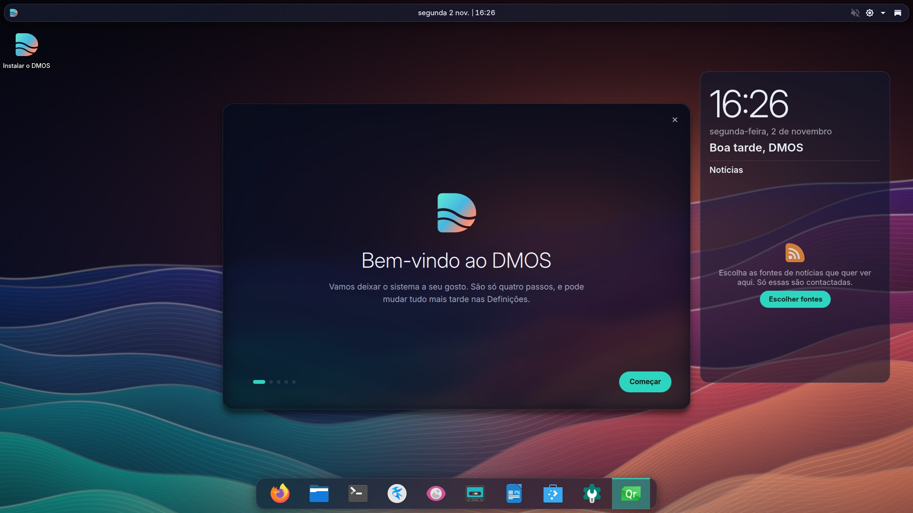 | 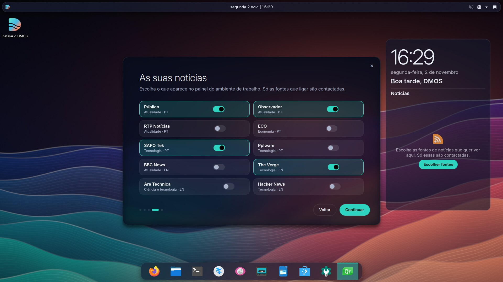 |

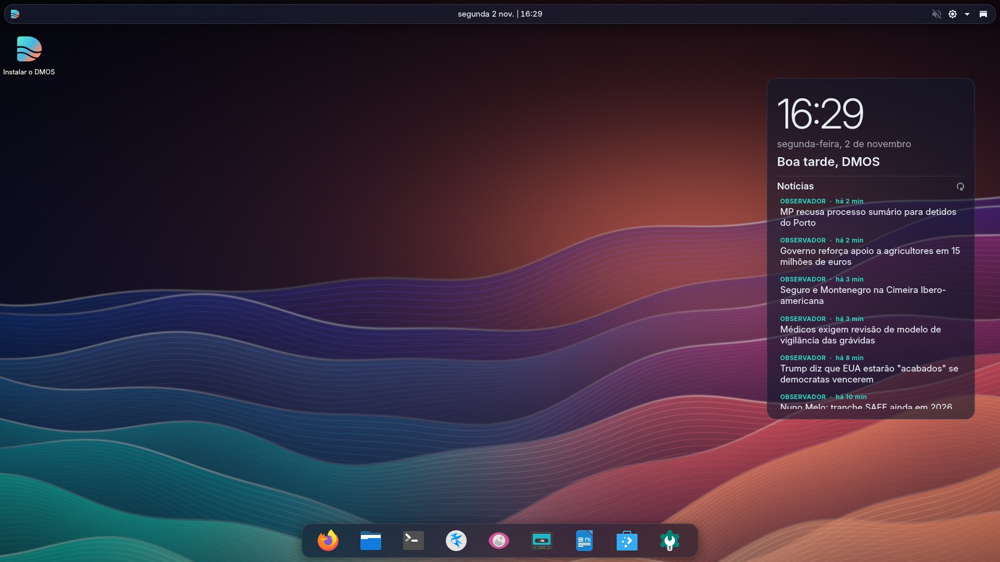

- **Português de Portugal completo** nos ecrãs de bloqueio e de "Sair" e no painel de aplicações,
  que no Debian ficavam em inglês. As traduções em falta ficam em `/usr/local/share/locale` e não
  substituem os ficheiros dos pacotes.
- **Em inglês, quando a sessão é inglesa**: o assistente, o DMOS Hub e a DMOS IA mudam de língua
  com a sessão.

## O que foi testado

A partir da 1.1, os testes são feitos no **VMware Workstation**, com aceleração por hardware e 3D,
numa máquina virtual UEFI com 4 GB de RAM e 4 processadores. Na 1.2, os cliques e as teclas passaram
a ser dados dentro da sessão por um script (`scripts/guest_input.py`), como se fossem de um rato e de
um teclado, e a instalação foi feita assim do princípio ao fim.

| Teste da 1.2 | VMware |
|---|---|
| ISO até ao ambiente de trabalho (Wayland), com o assistente aberto | Sim |
| Assistente de ponta a ponta: tema claro e escuro, fundo, cor de destaque, até «Começar a usar» | Sim |
| Painel de aplicações com **Super + A**, em português, com os favoritos do DMOS | Sim |
| DMOS Hub: pergunta escrita no campo «Pergunte à IA…» abre a DMOS IA | Sim |
| DMOS IA com o servidor de ensaio: chave recusada e aceite, resposta com fontes, parar, mudar de modelo | Sim |
| Assistente, DMOS Hub e DMOS IA em inglês | Sim, mudando a língua da sessão |
| Instalação completa (Apagar disco) e arranque do sistema instalado, com tudo o que a 1.2 traz | Sim |

Na 1.2 ficou por testar:

- A DMOS IA **com uma chave verdadeira**, isto é, a ligação ao serviço da Anthropic. Todos os testes
  usaram o servidor de ensaio do repositório, que imita a API na própria máquina.
- A entrada **Try DMOS (English)** do menu de arranque: o inglês foi testado mudando a língua de uma
  sessão já aberta.
- O Hyper-V, o VirtualBox e hardware real, onde só a 1.1 foi experimentada.

Um limite conhecido, que não é novo: se a resolução do ecrã mudar depois do primeiro arranque (por
exemplo, ao redimensionar a janela de uma máquina virtual) e a sessão for reiniciada, o DMOS Hub
pode saltar para o canto superior esquerdo. Arrasta-se de volta no modo de edição do ambiente de
trabalho.

| Teste da 1.1 | VMware |
|---|---|
| ISO até ao ambiente de trabalho (Wayland), em menos de um minuto | Sim |
| Ferramentas do VMware: resolução ajustada à janela e som | Sim |
| Assistente, com a página "Aplicações populares", nos temas escuro e claro | Sim |
| Aplicação do Flathub aberta no Discover a partir do assistente | Sim |
| Instalação completa e arranque do sistema instalado | Sim |

A instalação foi feita com a primeira compilação da 1.1. A compilação publicada só acrescenta o
catálogo do Flathub, testado na sessão de demonstração. A instalação também foi repetida no QEMU,
até ao fim, com a legenda das partições legível.

A compilação publicada da 1.1 foi ainda instalada no **Hyper-V** (Windows, máquina de geração 2 com
o Arranque Seguro desligado), do arranque da ISO ao sistema instalado, e corre bem. No
**VirtualBox** arranca, mas a sessão fica demasiado lenta com as definições de origem, por isso
não é recomendado (veja [Experimentar](#experimentar)).

Na 1.0, o menu de arranque, a sessão de demonstração e a instalação completa foram testados em BIOS
e em UEFI, no QEMU. Na 1.1 e na 1.2 só se testou UEFI.

Em **hardware real**, a 1.1 arrancou da pen e correu num **HP Omen de 2017**. Num **Toshiba Tecra
R840 de 2011** só não arrancou enquanto a pen estava gravada com a opção «Large FAT32» do Rufus, que
as BIOS antigas não leem: a causa foi o formato da pen, não o DMOS. Grave sempre em modo DD. Se experimentar noutro
computador, conte-nos o modelo e o que funcionou.

Ainda por testar:

- **Hardware real** em mais máquinas, incluindo placas gráficas NVIDIA, AMD e Intel e Wi-Fi em
  computadores diferentes.
- **Secure Boot**: a ISO inclui os componentes assinados, mas o arranque com ele ativo não foi
  experimentado. As fontes do menu não carregam nesse modo, por isso o menu usa a fonte de base.
- Modo de compatibilidade gráfica, disco encriptado, instalação ao lado de outro sistema e
  atualização do sistema com `apt`.

## O que foi desenhado

| Peça | Onde |
|---|---|
| Wallpapers "Maré" (claro e escuro), "Aurora" e "Âmbar" (4K, procedurais) | `art/gen_wallpaper.py` |
| Logótipo e ícones da DMOS IA e do painel de aplicações | `art/logo.svg`, `art/ia.svg`, `art/apps.svg` |
| Esquemas de cores, estilo Plasma (vidro), decoração de janelas, Konsole | `art/gen_theme.py` |
| Disposição: barra superior e dock flutuantes, ecrã de carregamento | `live/config/includes.chroot_after_packages/usr/share/plasma/look-and-feel/` |
| Ecrã de início de sessão (SDDM) | `live/config/includes.chroot_after_packages/usr/share/sddm/themes/dmos/` |
| Animação de arranque (Plymouth) | `live/config/includes.chroot_after_packages/usr/share/plymouth/themes/dmos/` |
| Menu de arranque (GRUB) | `live/config/bootloaders/grub-pc/`, `art/grub-theme.txt` |
| Instalador (Calamares) | `live/config/includes.chroot_after_packages/etc/calamares/` |
| Assistente "Bem-vindo ao DMOS" | `live/config/includes.chroot_after_packages/usr/share/dmos/welcome/` |
| Painel DMOS Hub e lista de fontes de notícias | `live/config/includes.chroot_after_packages/usr/share/plasma/plasmoids/org.dmos.hub/` |
| DMOS IA (janela e ligação ao Claude) | `live/config/includes.chroot_after_packages/usr/share/dmos/ia/`, `.../usr/lib/dmos-ia/` |
| Cor de destaque em todo o sistema | `live/config/includes.chroot_after_packages/usr/bin/dmos-accent` |
| Favoritos do menu e do painel de aplicações | `live/config/includes.chroot_after_packages/usr/bin/dmos-favorites` |
| Traduções em falta (pt) | `live/config/hooks/live/0530-dmos-pt-translations.hook.chroot` |

Fontes: Inter e JetBrains Mono. Ícones: Papirus. Cursor: Bibata.

## Compilar a ISO

Em Windows, com o WSL 2 disponível:

```powershell
.\build.ps1
```

Na primeira vez, o script cria uma instância WSL própria, `dmos-builder`, e não toca nas outras.
A compilação precisa de cerca de 20 GB livres e demora perto de 20 minutos, mais o tempo de
descarregar os pacotes na primeira vez.

Para repetir a compilação a partir do zero, mantendo os pacotes já descarregados:

```powershell
.\build.ps1 clean
```

```powershell
.\build.ps1
```

Para apagar tudo o que a compilação criou no WSL:

```bash
wsl --unregister dmos-builder
```

## Desenvolver o tema

Dentro de `dmos-builder`, como root, `scripts/dev_preview.sh` corre o ambiente real a partir de uma
cópia do sistema e tira uma captura de ecrã, sem compilar a ISO:

```bash
bash scripts/dev_preview.sh desktop
```

Os modos são `desktop`, `sddm` e `splash`, e as capturas ficam em `art/preview/`.
`scripts/test_vmware.ps1` controla, a partir do Windows, uma sessão de demonstração no VMware
Workstation: tira capturas, abre programas dentro da sessão e, com a ação `input`, clica e escreve
como um rato e um teclado a sério (`scripts/guest_input.py`). `scripts/test_vm.sh` faz o mesmo em
QEMU, dentro do `dmos-builder`, mas muito mais devagar, porque o WSL não tem aceleração por hardware.

A DMOS IA testa-se sem conta nem chave. `scripts/fake_claude.py` faz de API da Anthropic na própria
máquina, e `scripts/test_dmos_ia.py` corre contra ele, numa sessão do DMOS, as verificações da
chave, das respostas com fontes, dos erros e do botão de parar:

```bash
python3 scripts/test_dmos_ia.py
```

Para ver a janela com esse servidor de ensaio:

```bash
python3 scripts/fake_claude.py &
```

```bash
ANTHROPIC_BASE_URL=http://127.0.0.1:8377 ANTHROPIC_API_KEY=sk-ant-teste dmos-ia
```

## Site

O site do projeto está em `docs/` (`index.html`, `style.css`, `main.js`) e usa as capturas de
`docs/screenshots/`. Não precisa de compilação: abra `docs/index.html` no browser. Para o publicar
no GitHub Pages, em **Settings > Pages** escolha **Deploy from a branch**, o ramo `main` e a pasta
`/docs`.

## About DMOS (English)

DMOS is a Portuguese Linux distribution based on Debian 13 "trixie", featuring KDE Plasma 6 on
Wayland and a complete visual identity of its own: boot menu (GRUB), splash screen (Plymouth),
login screen (SDDM), a glass-style Plasma theme with light and dark variants, the procedural "Maré"
wallpaper and a branded Calamares installer. All artwork and configuration are generated from the
source code in this repository.

On top of that, DMOS has:

- **Welcome to DMOS**: a first-run assistant (light or dark look, wallpaper and accent colour,
  network, news sources, popular apps, shortcuts).
- **DMOS AI** (new in 1.2): a research assistant answered by Claude, which searches the web and
  shows the pages it cited. You bring your own Anthropic API key and pay Anthropic for what you
  use; no key ships in the ISO, and nothing is sent until you add one. Questions and the key go to
  Anthropic only. The key is stored in `~/.config/dmos/ia.key`, readable by your user alone.
- **Application dashboard** (new in 1.2): every app on one full-screen page, from the dock or
  with **Super + A**.
- **Flathub enabled out of the box**: Discover lists Flathub apps from the first boot.
- **DMOS Hub**: a desktop widget with the time, a greeting and news from the sources you choose.
  No source is enabled by default, so nothing is contacted until you opt in.
- **Complete European Portuguese** translations, including the lock and logout screens. Since
  1.2, the welcome assistant, the Hub and DMOS AI are in English in an English session.

| | |
|---|---|
| Based on | Debian 13 "trixie" (stable) |
| Desktop | KDE Plasma 6, Wayland by default |
| Architecture | x86_64 (amd64) |
| Boot | Hybrid ISO, BIOS and UEFI, live session |
| Installer | Calamares |
| Packages | APT (DEB), Flatpak |
| Default language | European Portuguese (an English live session is in the boot menu) |
| License | GPL-3.0-or-later; the wallpapers under CC BY-SA 4.0 |

**Download:** [DMOS 1.2 ISO](https://sourceforge.net/projects/dmos/files/latest/download) (2.9 GB, on SourceForge), with `SHA256SUMS` and the source code of
every package in the ISO in the [same folder](https://sourceforge.net/projects/dmos/files/1.2/).
What changed: [release notes](CHANGELOG.md) (in Portuguese).
Requirements: 64-bit PC, 4 GB of RAM, 2 CPU cores, 15 GB of disk to install.

**Testing status:** version 1.2 was tested on VMware Workstation (UEFI): the live session, a full
install and the installed system, with real clicks and keystrokes scripted inside the guest. DMOS
AI was tested against a stand-in API server that ships in this repository, never with a real key,
so the connection to Anthropic's service itself is untested. Version 1.0 was tested on QEMU in both
BIOS and UEFI modes. Version 1.1 was also installed on VMware Workstation and on Hyper-V
(generation 2, Secure Boot off), where it runs well. VirtualBox is not recommended: the desktop is
very slow with its default settings (use VMSVGA with 3D acceleration and the Plasma X11 session if
you must). On real hardware, 1.1 boots and runs from a USB stick on an HP Omen (2017); a Toshiba Tecra
R840 (2011) only failed while the USB stick was written with Rufus's "Large FAT32" option, which old
BIOSes cannot read: write the stick in DD mode. Secure Boot has not been tested yet.

**Supporting:** DMOS is free and made in spare time. If it is useful to you, you can
[sponsor the project on GitHub](https://github.com/sponsors/diogomadail1000-ship-it).

**Building:** on Windows with WSL 2, run `.\build.ps1` (see [Compilar a ISO](#compilar-a-iso)). It
uses live-build inside a dedicated `dmos-builder` WSL instance.

Website: <https://dmos.cc/> · [2-minute tour with English subtitles](https://youtu.be/v97XyyNyhDE) · Videos (Portuguese):
<https://www.youtube.com/playlist?list=PLbQLRzz4S7rQ>

DMOS is an independent project and is not affiliated with Debian, KDE or Anthropic.

## Apoiar

O DMOS é gratuito e feito nas horas livres. Se lhe for útil, pode
[apoiar o projeto no GitHub Sponsors](https://github.com/sponsors/diogomadail1000-ship-it). Experimentar, reportar
problemas e partilhar também ajuda muito.

## Licença

O código e os temas deste repositório estão sob a [GPL-3.0-or-later](LICENSE). Exceção: os
wallpapers "Maré", "Aurora" e "Âmbar" que `art/gen_wallpaper.py` gera estão sob a CC BY-SA 4.0.

O Debian, o KDE Plasma, as fontes, os ícones e as outras aplicações incluídas na ISO mantêm as
licenças próprias.

A DMOS IA usa o SDK oficial da Anthropic para Python (licença MIT). Como o Debian não o empacota, a
compilação vai buscá-lo ao PyPI, com as bibliotecas de que depende, para `/usr/lib/dmos-ia/vendor`.
A lista com as versões fica em `VERSIONS.txt`, nessa pasta, e cada biblioteca traz a sua licença.
Estas bibliotecas não estão no arquivo de código-fonte dos pacotes Debian; o código de cada uma
está no PyPI, na versão indicada. O Claude é um serviço da Anthropic e não faz parte do DMOS, que é
um projeto independente e não é afiliado à Anthropic.
