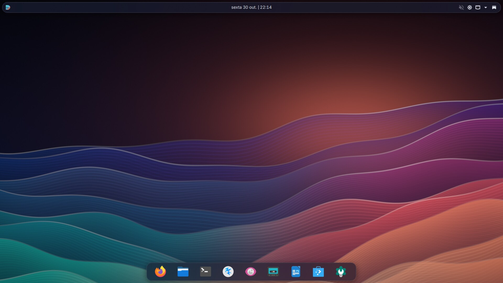
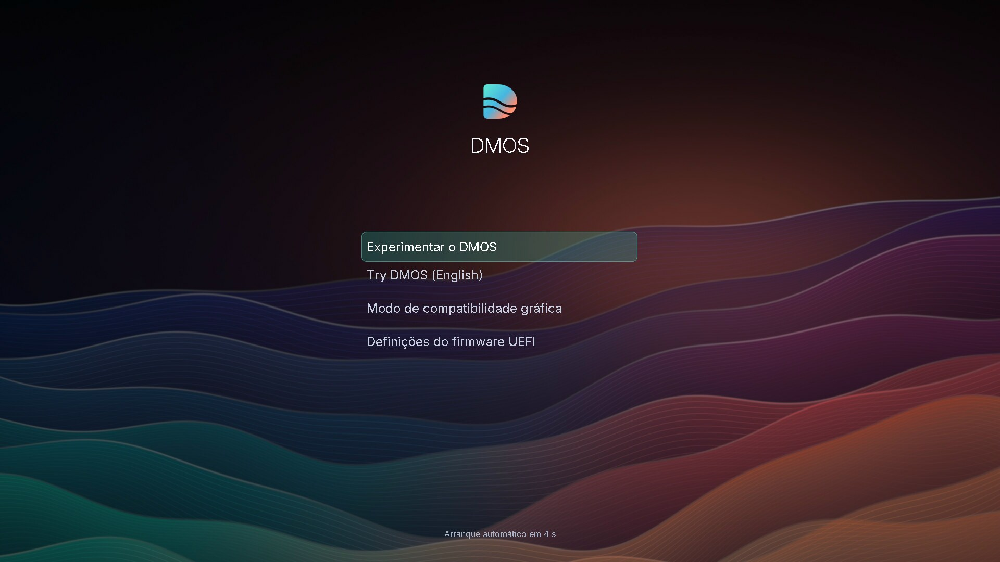
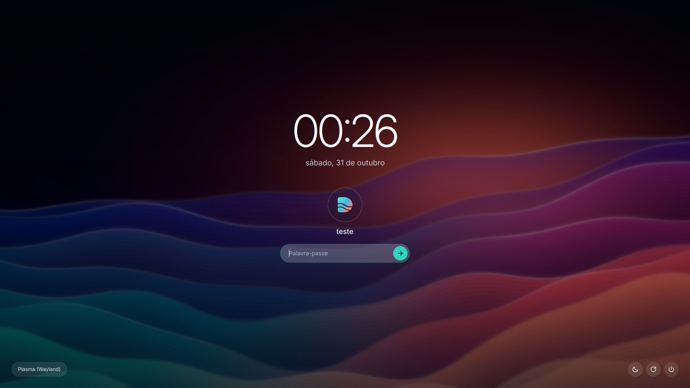
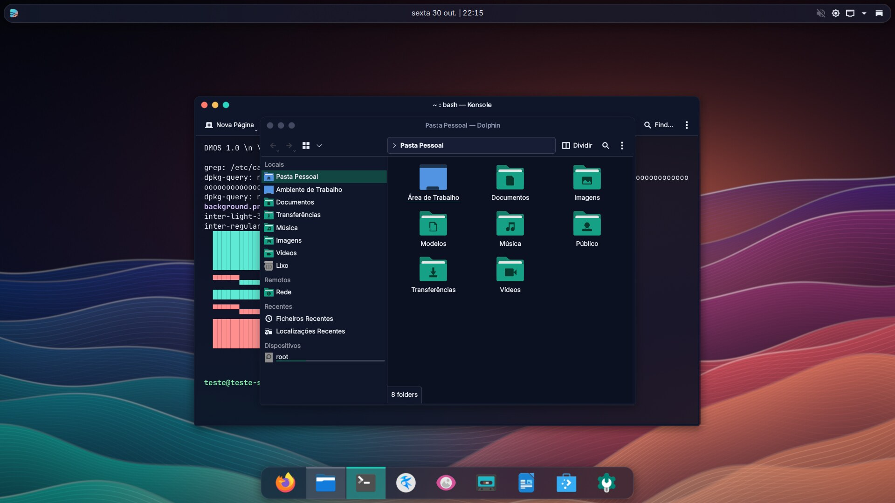
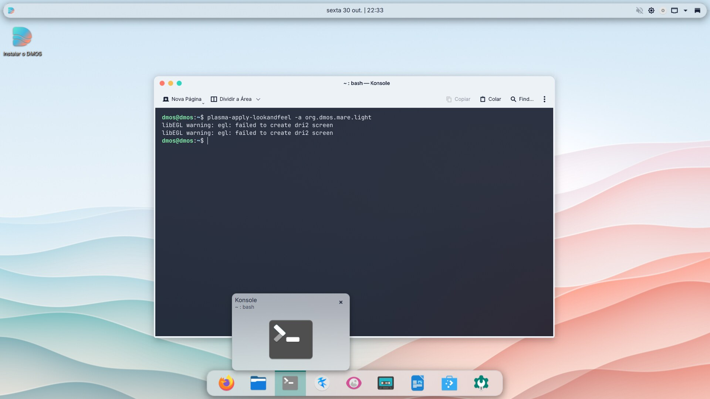
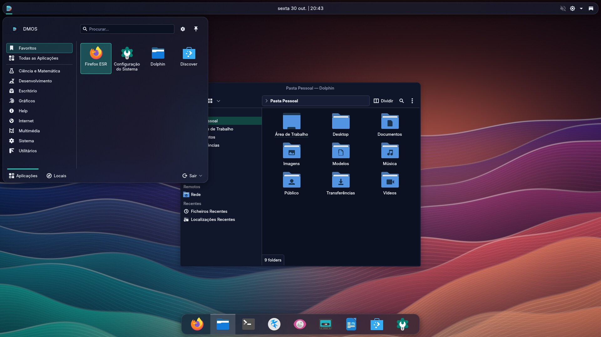
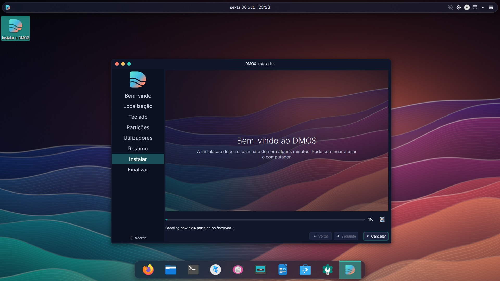

# DMOS 1.0 "Maré"

Distribuição Linux baseada no Debian 13 (trixie), com KDE Plasma 6 e uma identidade visual
própria, gerada a partir do código deste repositório.



| | |
|---|---|
|  |  |
|  |  |
|  |  |

## Experimentar

A ISO não faz parte do repositório, por ser demasiado grande para o GitHub. Depois de a
[compilar](#compilar-a-iso), fica em `dist/dmos-1.0-mare-amd64.hybrid.iso`, com o checksum em
`dist/SHA256SUMS`.

- **Numa máquina virtual** (VirtualBox, VMware, Hyper-V): tipo Linux/Debian 64 bits, pelo menos
  4 GB de RAM e 2 CPUs. Ative a aceleração 3D, se existir.
- **Numa pen USB**: grave a ISO com o [Rufus](https://rufus.ie) em modo DD, ou com o
  [balenaEtcher](https://etcher.balena.io). A gravação apaga o conteúdo da pen.

O sistema arranca sem instalar nada e entra sozinho com o utilizador `dmos`. Para o instalar, use
o ícone **Instalar o DMOS** no ambiente de trabalho. A instalação ocupa cerca de 7 GB e pede um
disco com pelo menos 15 GB.

Para mudar entre claro e escuro: **Definições do Sistema > Tema Global**.

## O que foi testado

Tudo em máquina virtual QEMU, sem aceleração por hardware.

| Teste | BIOS | UEFI |
|---|---|---|
| Menu de arranque com o tema | Sim | Sim |
| ISO até ao ambiente de trabalho (Wayland) | Sim | Sim |
| Instalação completa no disco e arranque do sistema instalado | Sim | Sim |

Também verificados: tema claro, entrada "Try DMOS (English)", Firefox e Dolphin.

A ISO final foi arrancada nos dois modos até ao ambiente de trabalho. As instalações completas foram
feitas em compilações anteriores; depois disso mudaram o tema do GRUB (aplicado e verificado à mão
num sistema instalado em BIOS) e foram acrescentadas as ferramentas do VMware.

Ainda por testar:

- **VMware e VirtualBox**: as ferramentas do VMware vêm incluídas, mas nunca correram num VMware.
- **Hardware real**, incluindo placas gráficas NVIDIA, AMD e Intel e Wi-Fi. O efeito de vidro e as
  animações só foram vistos com renderização por software.
- **Secure Boot**: a ISO inclui os componentes assinados, mas o arranque com ele ativo não foi
  experimentado. As fontes do menu não carregam nesse modo, por isso o menu usa a fonte de base.
- Modo de compatibilidade gráfica, disco encriptado, instalação ao lado de outro sistema e
  atualização do sistema com `apt`.

Limitação conhecida: na página de partições do instalador, os nomes da legenda ficam escuros sobre
o fundo escuro. A cor vem do Calamares e não do tema.

## O que foi desenhado

| Peça | Onde |
|---|---|
| Wallpaper "Maré" (claro e escuro, 4K, procedural) | `art/gen_wallpaper.py` |
| Logótipo | `art/logo.svg` |
| Esquemas de cores, estilo Plasma (vidro), decoração de janelas, Konsole | `art/gen_theme.py` |
| Disposição: barra superior e dock flutuantes, ecrã de carregamento | `live/config/includes.chroot_after_packages/usr/share/plasma/look-and-feel/` |
| Ecrã de início de sessão (SDDM) | `live/config/includes.chroot_after_packages/usr/share/sddm/themes/dmos/` |
| Animação de arranque (Plymouth) | `live/config/includes.chroot_after_packages/usr/share/plymouth/themes/dmos/` |
| Menu de arranque (GRUB) | `live/config/bootloaders/grub-pc/`, `art/grub-theme.txt` |
| Instalador (Calamares) | `live/config/includes.chroot_after_packages/etc/calamares/` |

Fontes: Inter e JetBrains Mono. Ícones: Papirus. Cursor: Bibata.

## Compilar a ISO

Em Windows, com o WSL 2 disponível:

```powershell
.\build.ps1
```

Na primeira vez, o script cria uma instância WSL própria, `dmos-builder`, e não toca nas outras.
A compilação precisa de cerca de 20 GB livres e demora perto de 20 minutos, mais o tempo de
descarregar os pacotes na primeira vez.

Para repetir a compilação a partir do zero, mantendo os pacotes já descarregados:

```powershell
.\build.ps1 clean
```

```powershell
.\build.ps1
```

Para apagar tudo o que a compilação criou no WSL:

```bash
wsl --unregister dmos-builder
```

## Desenvolver o tema

Dentro de `dmos-builder`, como root, `scripts/dev_preview.sh` corre o ambiente real a partir de uma
cópia do sistema e tira uma captura de ecrã, sem compilar a ISO:

```bash
bash scripts/dev_preview.sh desktop
```

Os modos são `desktop`, `sddm` e `splash`, e as capturas ficam em `art/preview/`.
`scripts/test_vm.sh` arranca a ISO em QEMU e controla a máquina virtual a partir da linha de comandos.

## Site

O site do projeto está em `docs/` (`index.html`, `style.css`, `main.js`) e usa as capturas de
`docs/screenshots/`. Não precisa de compilação: abra `docs/index.html` no browser. Para o publicar
no GitHub Pages, em **Settings > Pages** escolha **Deploy from a branch**, o ramo `main` e a pasta
`/docs`.

## Licença

O código e os temas deste repositório estão sob a [GPL-3.0-or-later](LICENSE). Exceção: o wallpaper
"Maré" que `art/gen_wallpaper.py` gera está sob a CC BY-SA 4.0.

O Debian, o KDE Plasma, as fontes, os ícones e as outras aplicações incluídas na ISO mantêm as
licenças próprias.
